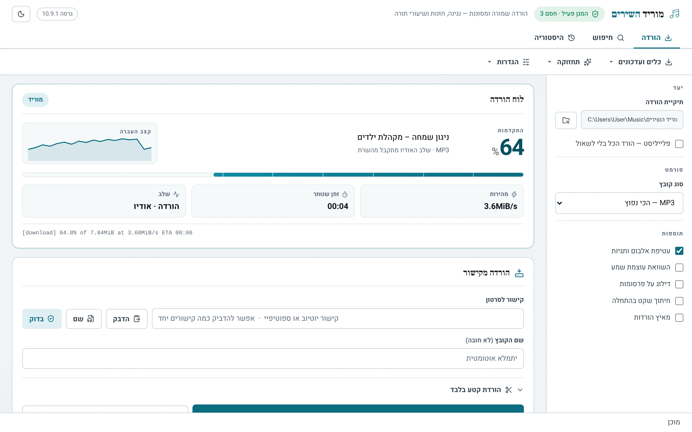
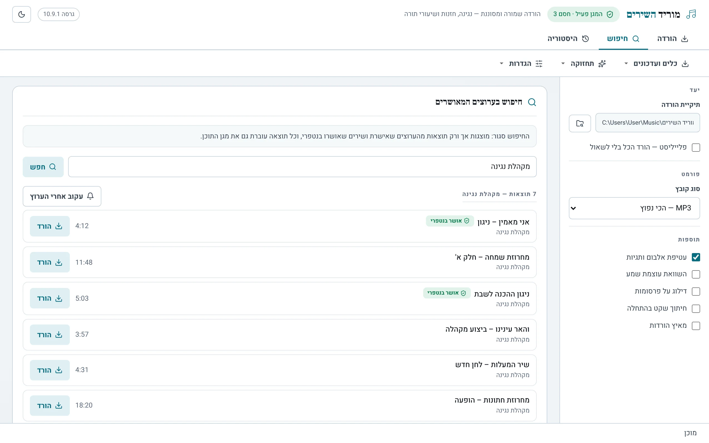
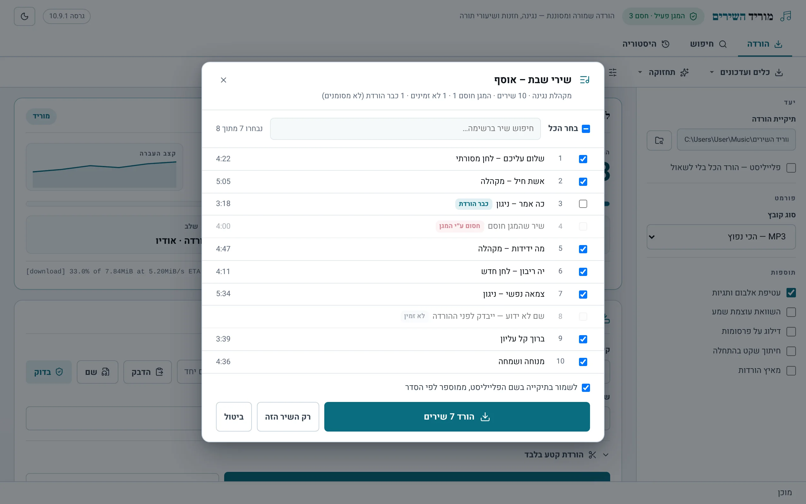
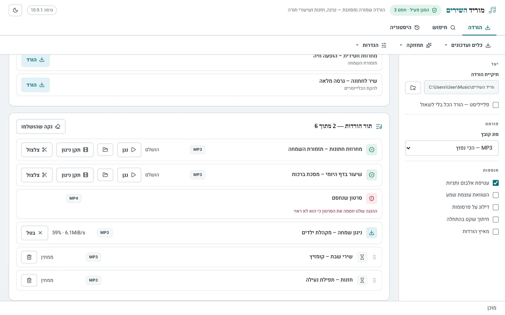
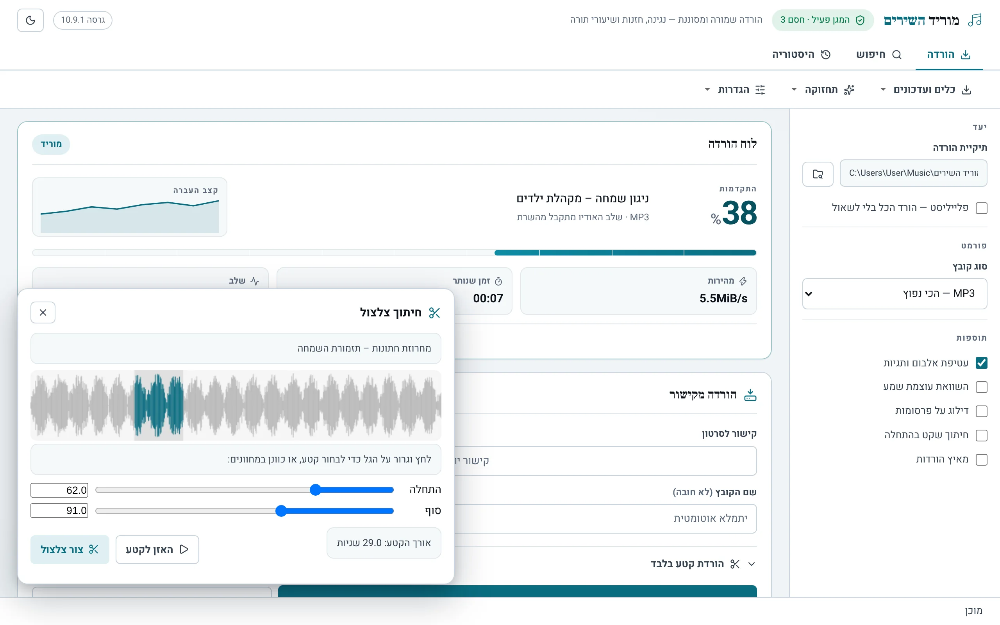
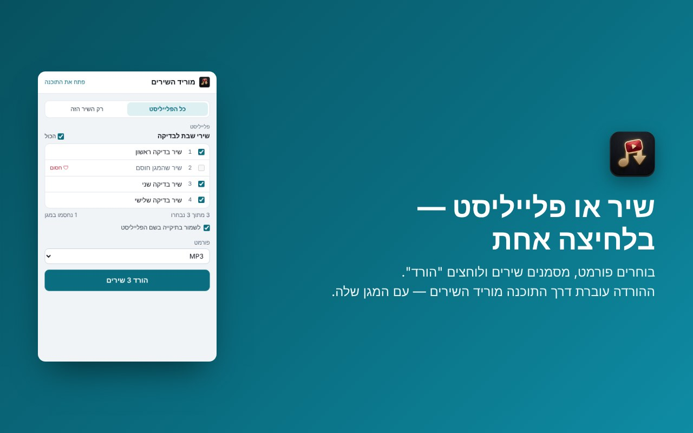
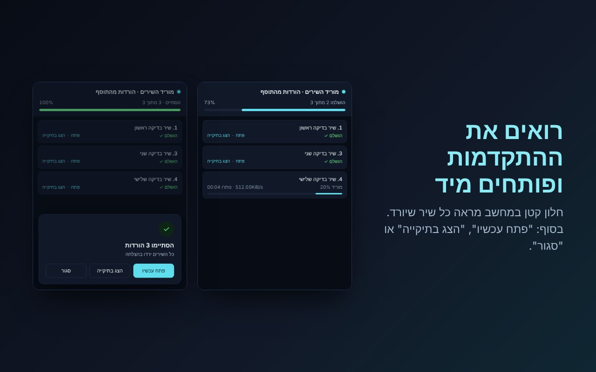

# מוריד השירים

  

תוכנה בעברית לווינדוס להורדת שירים ופלייליסטים כ-MP3 — עם חיפוש סגור, מגן תוכן מובנה, מאיץ הורדות ותמיכה מלאה ברשת נטפרי.

**[לדף התוכנה ←](https://hanyna.github.io/morid/)**

**גרסה נוכחית: 10.15**

## הורדה

| קובץ | למי |
|------|-----|
| [morid_setup_10.15.exe](https://github.com/hanyna/morid/releases/latest) | **התקנה ראשונה** — החבילה המלאה. כוללת את ffmpeg (ממיר ה-MP3), ומתקינה את רכיב WebView2 אם הוא חסר |
| [morid_update_10.15.exe](https://hanyna.github.io/morid/morid_update_10.15_web.exe) | **עדכון** של תוכנה שכבר מותקנת — קובץ קטן ומהיר (ובמחשב חדש הוא גם מתקין אותה) |

כל הגרסאות: [דף ההורדות](https://github.com/hanyna/morid/releases)

## צילומי מסך

| חיפוש | פלייליסט |
|:---:|:---:|
|  |  |
| **תור הורדות** | **צלצולים** |
|  |  |

### 🧩 התוסף לכרום בפעולה

| בוחרים שירים ופורמט | רואים את ההתקדמות ופותחים |
|:---:|:---:|
|  |  |

[להתקנת התוסף מהחנות של כרום ←](https://chromewebstore.google.com/detail/liddgbajcfnnffojoebeaakfhgeapmmb)

## מה חדש בגרסה 10.15

### 🧩 תוסף לכרום
- בדף של שיר או פלייליסט ביוטיוב לוחצים על התוסף, בוחרים פורמט (ובפלייליסט — אילו שירים) ולוחצים "הורד". חלון קטן מראה את ההתקדמות, ובסוף אפשר לפתוח את השיר או את התיקייה. ההורדה עוברת דרך התוכנה — עם המגן והסינון שלה. [התוסף בחנות של כרום](https://chromewebstore.google.com/detail/liddgbajcfnnffojoebeaakfhgeapmmb)
- עובד גם באתרים שאינם יוטיוב: פורום, בלוג או אתר עם סרטוני יוטיוב משובצים — רואים את רשימת הסרטונים שבדף ובוחרים מה להוריד
- התוכנה נשארת ברקע בשביל התוסף, כך שההורדה מתחילה מיד (אפשר לכבות בהגדרות)

### 🪶 קלה ומהירה יותר
- ממיר השמע (ffmpeg) נבנה מחדש במיוחד למוריד השירים — 20MB במקום 115MB, אותה איכות. התיקייה של התוכנה קטנה בהרבה, וההתקנה מהירה יותר
- החלון נפתח מהר, ומנוע ההורדה מותקן פרוס מראש — בלי המתנה של כמה שניות בכל הורדה

### 🛡️ סינון ונטפרי
- נטפרי כסמכות: סרטון שנטפרי מאשר מאושר אוטומטית (מגן בסיס נגד גסויות חל תמיד)
- תוקן: בנטפרי דרך בזק ההורדה נכשלה ב-"HTTP Error 418"; עכשיו עוברת דרך הנתיב של נטפרי
- סרטון שהסינון מאשר יורד גם כשהסינון חוסם את הקבצים באיכות גבוהה

### 🧷 תיקונים
- תוקן: סרטונים שירדו כעשרות "קטעים" (קבצים בשם ‎.part-Frag) או שהתוכן חזר על עצמו — התוכנה מעדיפה את הקובץ הרגיל של יוטיוב, ו"תקן סרטונים שלא נפתחים" מנקה קטעים שנשארו
- מוריד השירים מופיע ב"אפליקציות ותכונות" של Windows, עם הסרה מסודרת (השירים שהורדת נשארים)
- בדיקת המערכת מציגה זמני פתיחה והורדה מפורטים, כדי לאתר מה מאט

הגרסאות הקודמות: [היסטוריית גרסאות](CHANGELOG.md)

## רישיון
כל הזכויות שמורות © LANDESBERG · ליצירת קשר: hanynalandesberg@gmail.com

התוכנה משתמשת ברכיבי קוד פתוח: [yt-dlp](https://github.com/yt-dlp/yt-dlp) (רישיון Unlicense) ו-[FFmpeg](https://ffmpeg.org) (רישיון GPL, גרסה 2 ואילך; ה-build שבשימוש ומקורותיו: [ffmpeg-min](https://github.com/hanyna/morid/releases/tag/ffmpeg-min)). נוסח הרישיונות המלא זמין גם בתוך התוכנה, בתפריט תחזוקה ← אודות.

## In English

**Morid** is a Hebrew-language Windows app for downloading songs and playlists as MP3. It includes a curated search, a built-in content filter, a multi-connection download accelerator, and full support for filtered networks (NetFree). Download the installer from the [Releases page](https://github.com/hanyna/morid/releases) or visit the [project website](https://hanyna.github.io/morid/).

