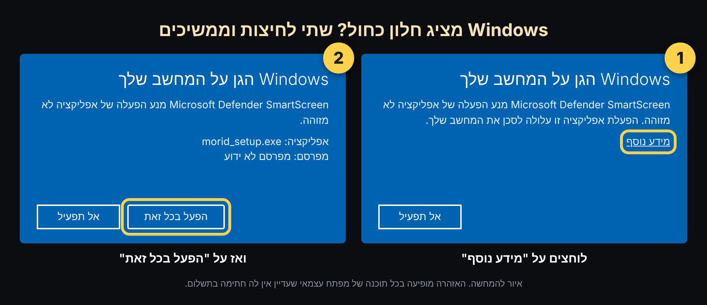
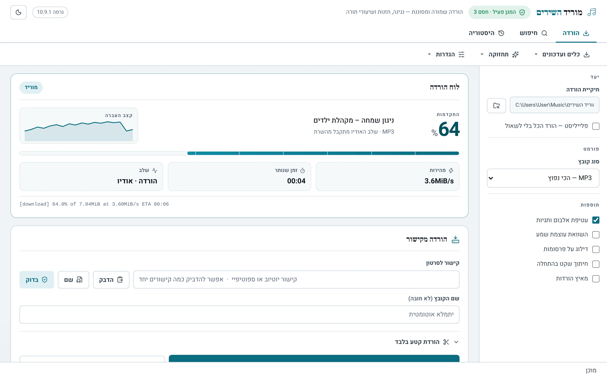
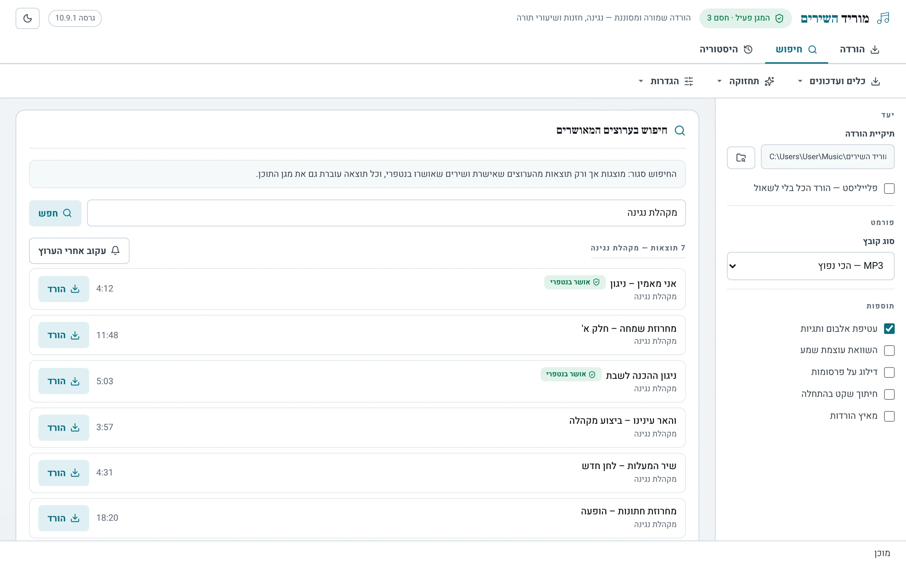
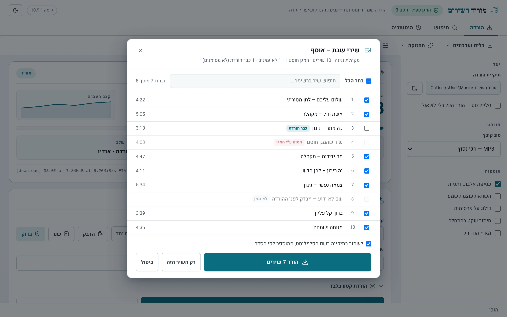
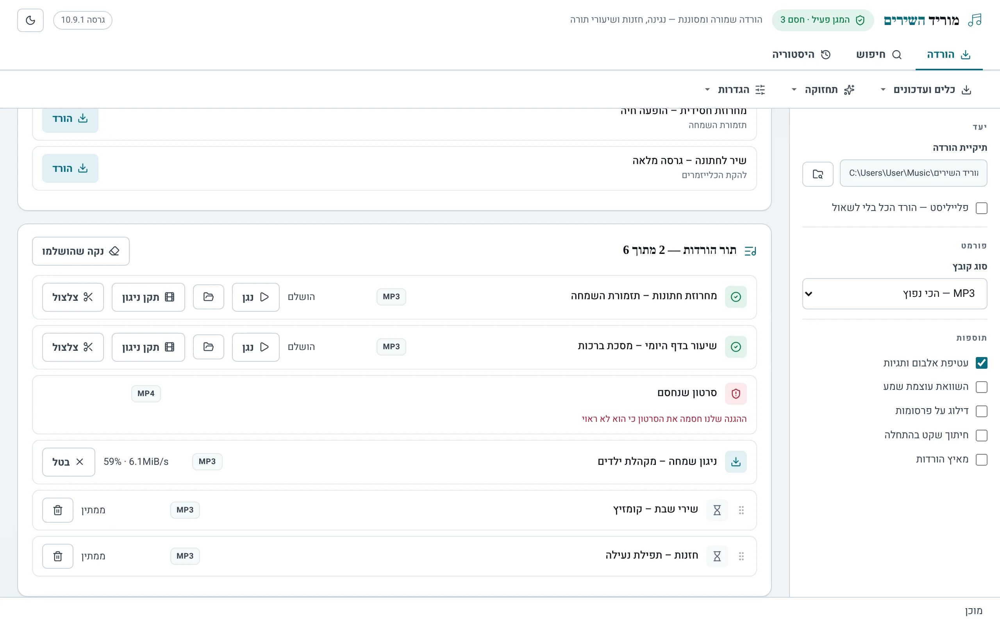
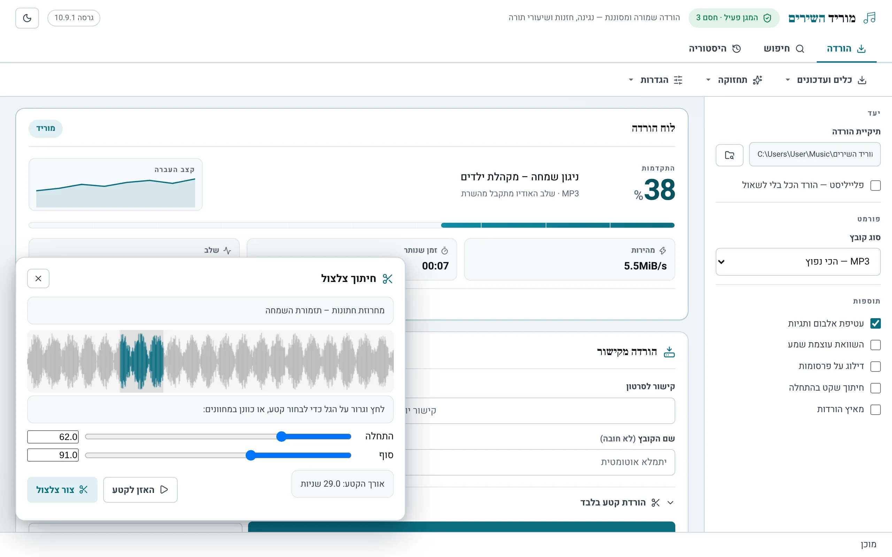
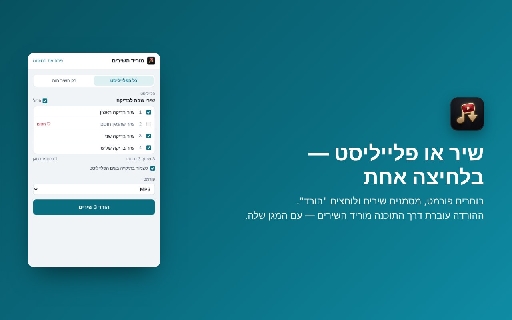
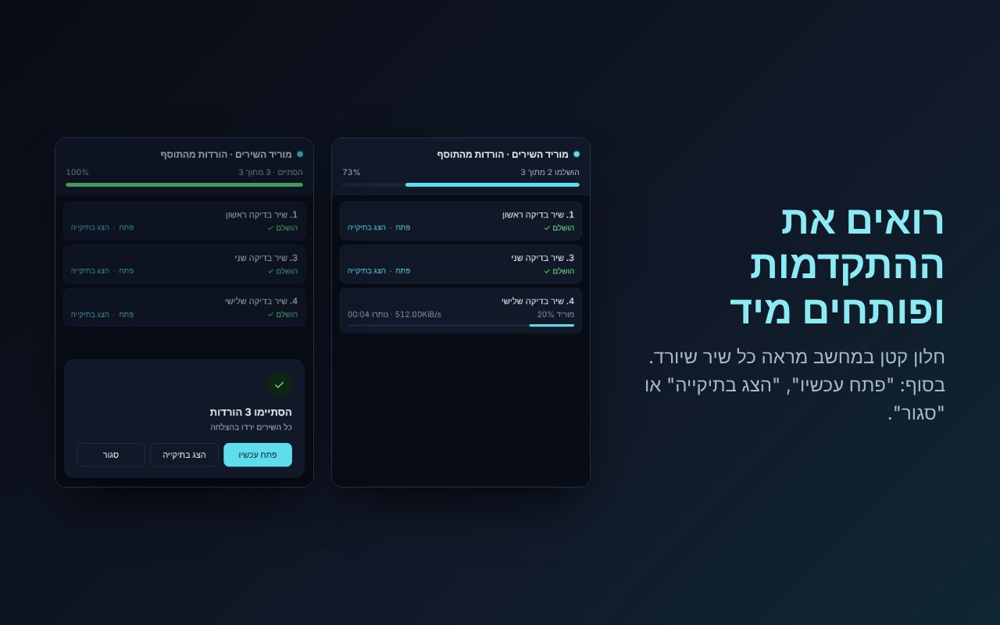

# מוריד השירים

  

תוכנה בעברית לווינדוס להורדת שירים ופלייליסטים כ-MP3 — עם חיפוש סגור, מגן תוכן מובנה, מאיץ הורדות ותמיכה מלאה ברשת נטפרי.

**[לדף התוכנה ←](https://hanyna.github.io/morid/)**

**גרסה נוכחית: 10.16**

## הורדה

| קובץ | למי |
|------|-----|
| [morid_setup_10.16.exe](https://github.com/hanyna/morid/releases/download/v10.16/morid_setup_10.16.exe) | **התקנה ראשונה** — החבילה המלאה. כוללת את ffmpeg (ממיר ה-MP3), ומתקינה את רכיב WebView2 אם הוא חסר |
| [morid_update_10.16.exe](https://github.com/hanyna/morid/raw/main/morid_update_10.16_web.exe) | **עדכון** של תוכנה שכבר מותקנת — קובץ קטן ומהיר (ובמחשב חדש הוא גם מתקין אותה) |

כל הגרסאות: [דף ההורדות](https://github.com/hanyna/morid/releases)

**אם Windows מציג חלון כחול ("Windows הגן על המחשב שלך"):** זה רגיל לתוכנות של מפתחים עצמאיים. לוחצים על **"מידע נוסף"** ואז על **"הפעל בכל זאת"**.

  

## צילומי מסך

  

| חיפוש | פלייליסט |
|:---:|:---:|
|  |  |
| **תור הורדות** | **צלצולים** |
|  |  |

### 🧩 התוסף לכרום בפעולה

| בוחרים שירים ופורמט | רואים את ההתקדמות ופותחים |
|:---:|:---:|
|  |  |

[להתקנת התוסף מהחנות של כרום ←](https://chromewebstore.google.com/detail/liddgbajcfnnffojoebeaakfhgeapmmb)

## מה חדש בגרסה 10.16

### ✨ חדש ומשופר
- ⚡ המרה ל-MP3 מהירה בהרבה: ההמרה רצה עכשיו על כל ליבות המעבד במקביל. הקלטה של שעתיים שלקחה כמעט שלוש דקות מומרת בשניות — באותה איכות
- 👤 חדש: קישור של ערוץ של זמר נפתח כרשימת שירים. מדביקים את הקישור של הערוץ ביוטיוב, רואים את כל השירים שלו, בוחרים מה להוריד — והכול נשמר בתיקייה בשם הזמר. המגן בודק כל שיר בנפרד
- 📱 חדש: פורמט "3GP — לטלפון פשוט". התוכנה ממירה את הסרטון לקובץ קטן שמתנגן בטלפונים פשוטים, בשתי רמות לבחירה: "תואם לכל טלפון" או "איכות טובה יותר"
- 🎬 תמיכה ב-YouTube Shorts: קישור של סרטון קצר יורד כמו כל שיר — עם המגן, הסינון וההיסטוריה. קישור ללשונית ה-Shorts של ערוץ נפתח כרשימה של הסרטונים הקצרים שלו
- 🖼️ על עטיפת כל שיר מופיע השם של מוריד השירים, ושיר בלי תמונה מקבל את התמונה של התוכנה (ב-MP3, M4A ו-FLAC)
- 📚 נוספו לחיפוש יותר מ-160 ערוצים חדשים של זמרים, מקהלות ושיעורים
- 🚀 מאיץ ההורדות דלוק עכשיו כברירת מחדל — הורדה בכמה חיבורים במקביל. אפשר לכבות אותו בצד, והבחירה נשמרת
- 🎨 מסך ההורדה סודר מחדש: תיבת הקישור והכפתור "הורד עכשיו" למעלה, שורת ניווט אחת, הסבר קצר מתחת לכל תוספת, ושם השיר בתור מוצג במלואו בריחוף
- 🔄 בתור ההורדות: כפתור "נסה שוב" בכל שורה שנכשלה, ו-✕ להסרת שורה שנכשלה או שהושלמה (הקובץ שירד לא נמחק)
- 👋 הדרכה קצרה למי שפותח את התוכנה בפעם הראשונה: שלושה שלבים עד השיר הראשון, עם כפתורי "הדבק קישור" ו"חפש זמר"
- 🔤 הגופנים של התוכנה ארוזים עכשיו בתוכה — הכתב נראה אותו דבר בכל מחשב

### 🧷 תיקונים
- 🛠️ תוקן: "דילוג על פרסומות" הפיל הורדות בשגיאה "ffprobe not found" — עכשיו הוא עובד
- 🛠️ תוקן: "כתוביות עברית ואנגלית" נכשל — הכתוביות נשמרות עכשיו ליד הסרטון
- 🔊 תוקן: "השוואת עוצמת שמע" שינתה את קצב הדגימה של הקובץ, ובנגנים פשוטים וברכב הוא לא תמיד התנגן. עכשיו הקצב נשמר, וב-MP3 היישור נעשה בתוך ההמרה — קידוד אחד במקום שניים
- 🛡️ תוקן: הורדה מהתוסף לכרום שנכשלה ב"הגיע קובץ בלי שמע" כשהסרטון פתוח בסינון (נטפרי, רימון, אתרוג). התוכנה מזהה שהסינון חסם רק את קובץ השמע, מורידה את הקובץ הרגיל כמו שהדפדפן מנגן, ואם גם זה לא עובר — מסבירה מה לעשות
- ⏱️ תוקן: הורדה שנשארה על "ממיר" בלי סוף ותפסה מקום בתור — המרה שנתקעת נעצרת עכשיו לבד ומתחילה מחדש
- ⏹️ תוקן: "בטל" בזמן ההמרה, חיתוך השקט או יישור העוצמה לא ביטל — ההורדה הסתיימה כ"הושלם". עכשיו הביטול עוצר מיד
- ✂️ תוקן: כפתור "צלצול" לא עבד בשיר שיש גרש בשם שלו
- 🎬 "תקן ניגון" מופיע רק בסרטונים, עובד גם בסרטון עם תמונת עטיפה או בגודל לא רגיל, ומודיע בסוף אם הצליח
- 🎧 תוקן: סרטון MP4 או MKV ירד לפעמים עם פס קול מדובב במקום המקורי — עכשיו נבחר פס הקול המקורי
- 🔧 תוקן: "התקן מחדש את מנוע ההורדה" ועדכון המנוע נכשלו ב-"Access is denied" או "engine dir busy" אחרי שהאנטי-וירוס נגע בקבצים
- 🔎 בדיקת מערכת: שגיאת ההורדה האחרונה מוצגת בשורה נפרדת (פעולות רקע לא מסתירות אותה), עם פירוט זמנים מדויק של כל שלב בהורדה
- 🔒 אבטחה: קובצי העדכון, המנוע והכלים יורדים רק בחיבור מאומת ונבדקים לפני ההפעלה, והשרת הפנימי של התוכנה הוקשח
- 🪟 תוקן: בפתיחת התוכנה החלון הופיע ריק, נעלם והופיע שוב — עכשיו הוא נפתח פעם אחת ונשאר פתוח
- 🧹 הסרת התוכנה דרך "אפליקציות ותכונות" לא משאירה יותר תיקייה עם קבצים קטנים

הגרסאות הקודמות: [היסטוריית גרסאות](CHANGELOG.md)

## רישיון
כל הזכויות שמורות © LANDESBERG · ליצירת קשר: hanynalandesberg@gmail.com

התוכנה משתמשת ברכיבי קוד פתוח: [yt-dlp](https://github.com/yt-dlp/yt-dlp) (רישיון Unlicense) ו-[FFmpeg](https://ffmpeg.org) (רישיון GPL, גרסה 2 ואילך; ה-build שבשימוש ומקורותיו: [ffmpeg-min](https://github.com/hanyna/morid/releases/tag/ffmpeg-min)). נוסח הרישיונות המלא זמין גם בתוך התוכנה, בתפריט תחזוקה ← אודות.

## In English

**Morid** is a Hebrew-language Windows app for downloading songs and playlists as MP3. It includes a curated search, a built-in content filter, a multi-connection download accelerator, and full support for filtered networks (NetFree). Download the installer from the [Releases page](https://github.com/hanyna/morid/releases) or visit the [project website](https://hanyna.github.io/morid/).

